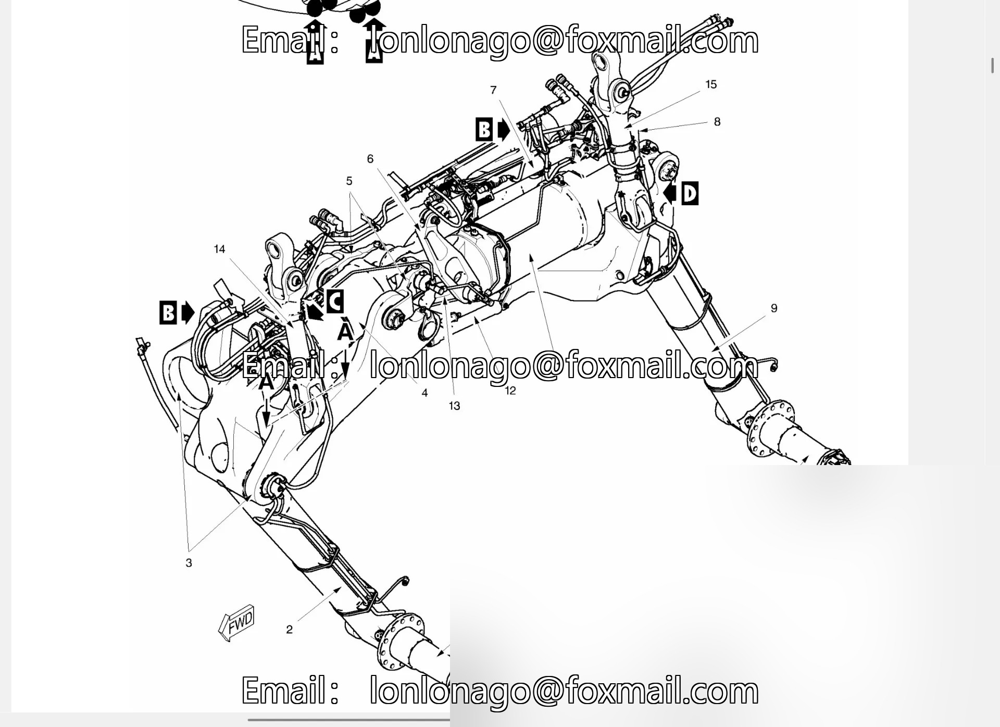
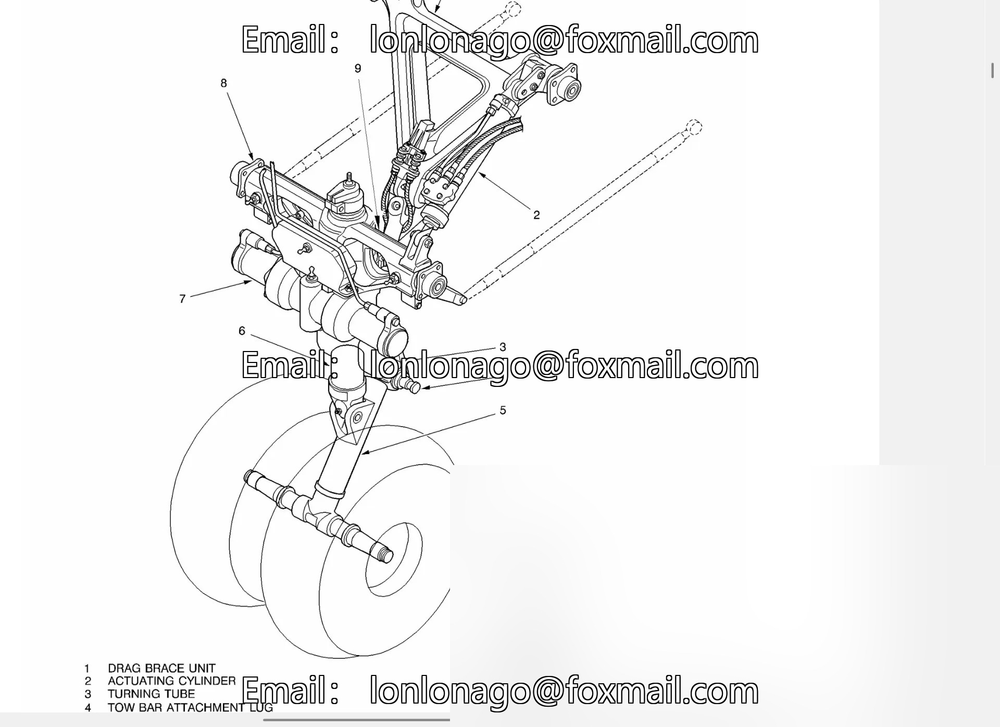
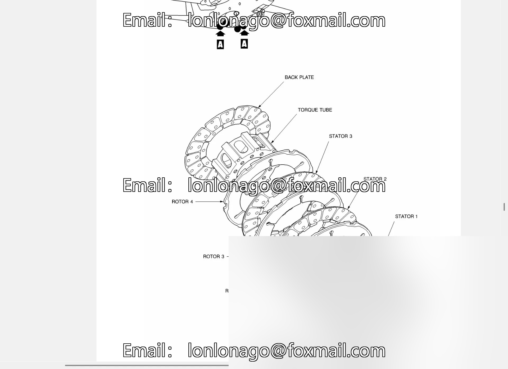
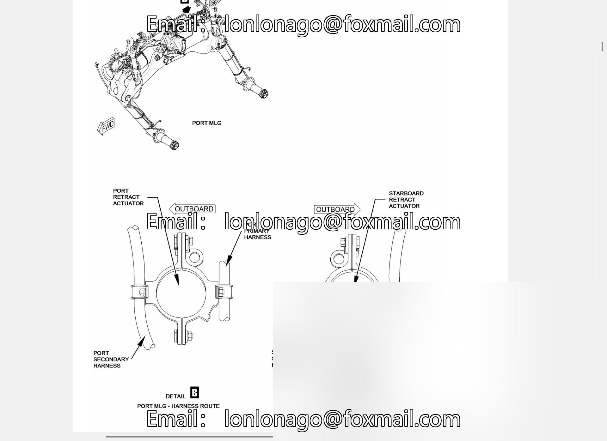
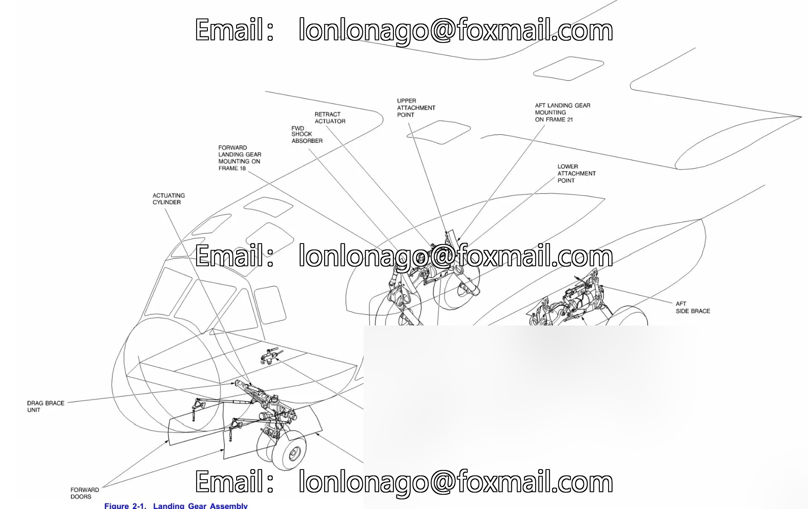

# Mexican Air Force C-27J aircraft - Landing gear maintenance technical manual 400 pages

## Body

Mexican Air Force C-27J aircraft - Ground maintenance technology manual of 400 pages.
The C-27J is a medium tactical transport aircraft developed by Italy's Alenia Armazani (now incorporated into Leonardo) on the basis of the mature G.222 transport aircraft, deeply improved and developed. Its design goal is to fill the air transport capacity gap between light general helicopters and large strategic transport aircraft (such as C-130), and is hailed as "the precise tool for tactical air transport."

This is the maintenance technical manual for the Mexico Air Force C-27J aircraft, 400 pages, covering landing gear related maintenance components and configurations, including multiple maintenance units and diagrams.

<!-- AI_ENRICHED -->

## Images

## Payment

Here is a pay link on Stripe ( https://buy.stripe.com/3cs8yP7sY87d0vu9AB ). Please contact me lonlonago@foxmail.com after funding $89, and I will send you a complete data files , thank you!

